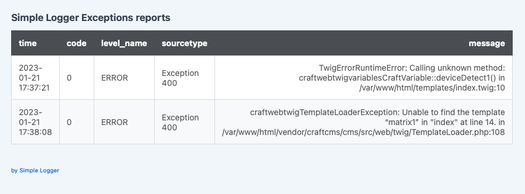

Simple Logger plugin for Craft CMS
===

Plugin for collecting exception handler logs and reporting over email.
A simple solution for those who can't or won't pay for corporate logging solutions like New Relic, Dynatrace, Datadog, and others.

### Requirements

This plugin requires:
- Craft CMS `^5.0.0`
- PHP `^8.2 || ^8.3 || ^8.4 || ^8.5`

### If you don't receive daily emails, check:

1. If your email setup is correct
2. If Simple Logger plugin is active (`LOGGER_ON=1`)
3. If you have exceptions in `storage/logs/simplelogger.json`

### Installation

```bash
composer require leowebguy/simple-logger -w && php craft plugin/install simple-logger
```

### Usage

Set these `.env` parameters to configure Simple Logger:

```dotenv
# Simple Logger
LOGGER_ON=1
LOGGER_EMAIL=john@email.com
```

`LOGGER_EMAIL` accepts multiple comma-separated emails:
```dotenv
LOGGER_EMAIL=john@email.com,jane@email.com
```

If `LOGGER_EMAIL` is not set, Simple Logger defaults to sending the report to all Craft CMS administrators.

The plugin listens to Craft's `ErrorHandler::EVENT_BEFORE_HANDLE_EXCEPTION` event to capture exceptions, logging them to `storage/logs/simplelogger.json`:

```json
[
  {
    "time": "2026-11-01 17:37:21",
    "sourcetype": "Exception 400",
    "level_name": "ERROR",
    "message": "Twig\\Error\\RuntimeError: Calling unknown method: craft\\web\\twig\\variables\\CraftVariable::deviceDetect1() in /var/www/html/templates/index.twig:10"
  }
]
```

Once a day, Simple Logger processes the log file and queues a background email job (`EmailJob`) to the configured recipient(s).



Simple Logger automatically ignores `NotFoundHttpException` exceptions (such as 404s for nonexistent pages or missing static assets).

### Development & Testing

```bash
# Run PHPStan Level 8 static analysis
composer phpstan

# Check PSR-12 code style
composer pint-test

# Auto-fix PSR-12 code style
composer pint

# Run Craft 5 Rector rules
composer rector
```

### Feeling creative?

PR into https://github.com/leowebguy/simple-logger
